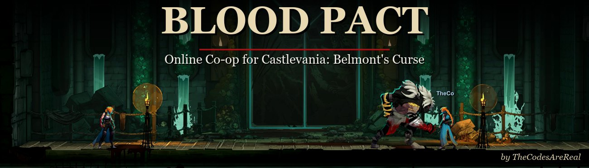
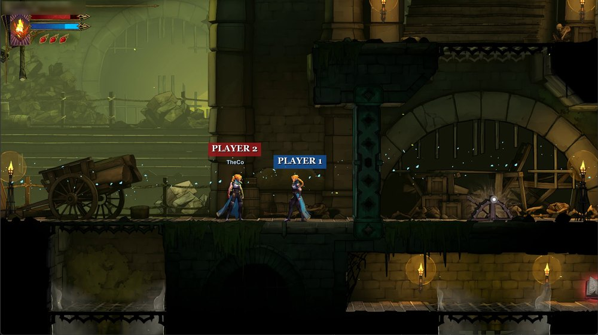

<p align="center">
  
</p>

<p align="center">
  <b>Online co-op for Castlevania: Belmont's Curse.</b><br>
  Two players, two games, one world.
</p>

<p align="center">
  <a href="#install">Install</a> ·
  <a href="CHANGELOG.md">Changelog</a> ·
  <a href="#reporting-a-bug">Report a bug</a> ·
  <a href="CONTRIBUTING.md">Contributing</a>
</p>

---

## Features

- **Play together online.** Each player runs their own game and save; Blood Pact keeps both worlds in step.
- **See each other.** Your partner's Rose is fully animated, with their attacks, spells and effects.
- **Fight together.** Shared monsters that hit and can be hit by both players, and go after whoever is closer.
- **Boss fights.** "Fight together?" brings your partner in. Fall, and you watch; win, and the reward is yours too.
- **Locked-room fights.** Shared waves for both players. Fall, and you watch your partner finish it.
- **Shared world.** Doors, levers, gates and drawbridges move for both. Chest items reach your partner anywhere.
- **Your own rewards.** EXP statues, upgrades, stat books and food: each player gets their own.
- **Shared resting.** Rest at a mirror and the monsters respawn for both, Souls style.
- **Co-op difficulty.** Monsters x1.3 and bosses x1.6 health while together (adjustable).
- **Free roam.** Explore apart and meet up; your partner is shown on the map.

## Install

You need the game (**1.1.3**, Steam) and both players on the **same Blood Pact version**.

1. Open the game folder: Steam › right-click the game › **Manage › Browse local files**.
2. Extract the whole release zip there, next to `Castlevania Belmont's Curse.exe`.
3. **Host only:** in `BepInEx\config\com.rosenet.tailscale.cfg`, set `Role = Host`.
4. Start the game. The first start takes a few minutes (black window while the mod loader sets up).

Be Steam friends; the host loads their save first, then the guest. No IP or port needed.
[Tailscale](https://tailscale.com) works as a backup.

## Screenshots

<p align="center">
  <br>
  <sub>Each player sees the other's Rose, named and tinted.</sub>
</p>

## Reporting a bug

Press **F10** right after it happens (either player). Open an issue with what happened, your versions, and the
folder it made in `BepInEx\BloodPact-reports` (both players' logs). Restarted already? Your last 5 sessions are
in `BepInEx\BloodPact-logs`.

<details>
<summary><b>Settings</b></summary>

<br>In `BepInEx\config\com.rosenet.tailscale.cfg`:

| Setting | Default | |
|---|---|---|
| `[Session] Role` | `Guest` | `Host` or `Guest` |
| `[Session] Transport` | `Steam` | `Steam`, or `Udp` for Tailscale |
| `[Session] UdpHostAddress` | | Tailscale: the host's `100.x.y.z` |
| `[Session] UdpPort` | `27852` | Tailscale: allow it in the host's firewall |
| `[Difficulty] Enabled` | `true` | Co-op health (factors in the same section) |
| `[Display] OtherRoseTint` | `#B8CCFF` | Tint of your partner's Rose |
| `[Display] ShowNameTag` | `true` | Name above your partner |
| `[Display] ShowStatus` | `true` | Connection line, top left |

Per launch: `--rosenet-role host|guest`, `--rosenet-transport steam|udp`, `--rosenet-host <address>`,
`--rosenet-port <port>`.
</details>

<details>
<summary><b>Building from source</b></summary>

<br>Needs the .NET 9 SDK and the game with [BepInEx 6.0.0-be.789](https://builds.bepinex.dev/projects/bepinex_be)
installed and started once (the project uses the game's generated interop assemblies; none are in this repository).

```
cd Plugin
dotnet build -c Release -p:GameDir="<game folder>"
```

Add `-p:Deploy=true` to copy the DLL into the game's `BepInEx\plugins\RoseNet`.
</details>

<details>
<summary><b>Self-test</b></summary>

<br>`tools\selftest.ps1` plays scenarios on two copies of the game on one PC (no saves written) and prints
PASS/FAIL:

```
powershell -ExecutionPolicy Bypass -File tools\selftest.ps1 -Scenario all -Slot 0
```

Scenarios: `both-up-win`, `partner-down-win`, `owner-down-win` (pick the boss with `-Boss`/`-Level`),
`encounter` (who dies: `-Encounter owner|partner|none`), `monsters`, `zombies`, `chest`, `statue`, `bridges`,
`doors`, `leave`, `fall`. Options: `-GuestFirst`, `-Lag <ms>`, `-Loss <%>`.
Don't touch the game windows while it runs; logs go to `BepInEx\BloodPact-test-logs`.
</details>

## Credits

Made by **TheCodesAreReal**. Inspired by **RoseCoop (Shared Curse)**, the local co-op mod; no code is shared,
and Blood Pact's optional [remote-controller mode](docs/REMOTE_CONTROLLER.md) works alongside it. Built on
[BepInEx](https://github.com/BepInEx/BepInEx), [HarmonyX](https://github.com/BepInEx/HarmonyX) and
[Il2CppInterop](https://github.com/BepInEx/Il2CppInterop).

<sub>Released under the [MIT License](LICENSE). A fan-made mod, not affiliated with or endorsed by Konami.
Castlevania is a trademark of Konami Digital Entertainment. You need your own copy of the game.</sub>
